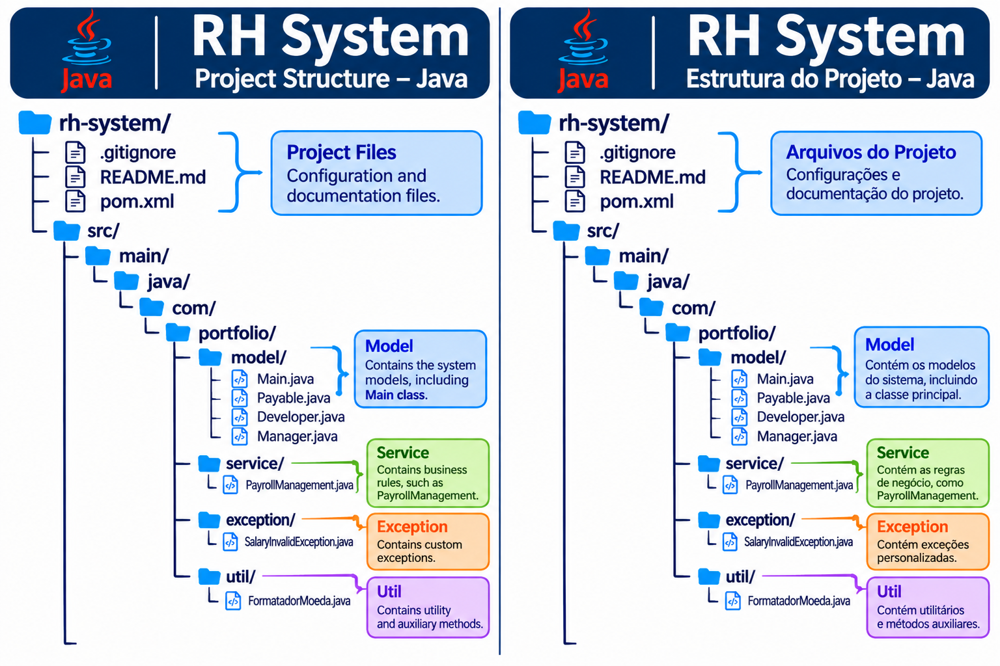

# RH System – Human Resources Management System
# RH System – Sistema de Gestão de Recursos Humanos

---

# English Version

## About the Project

RH System is a Java application developed to demonstrate concepts of Object-Oriented Programming (OOP) and Collections.

The system allows users to register employees, manage a collection of payment records, and calculate the total payroll.

## Technologies Used

- Java
- ArrayList
- List
- OOP (Object-Oriented Programming)
- BigDecimal
- Git
- GitHub

## Concepts Applied

- Interfaces
- Concrete Classes
- Encapsulation
- Polymorphism
- Collections Framework
- List and ArrayList
- For-each Loop

## Project Structure

## Package Organization

- **model**: Contains the `Payable` interface and employee classes (`Developer` and `Manager`).
- **service**: Contains the `PayrollManagement` class, responsible for employee management and payroll calculations.
- **com.portfolio**: Contains the `Main` class, which serves as the application's entry point.
- **exception**: Contains custom exception classes, responsible for handling specific application errors, such as invalid salary values.
- **util**: Contains utility classes with reusable helper methods, such as currency formatting and data validation.

## Features

- Developer registration
- Manager registration
- Employee listing
- Employee removal
- Individual payment calculation
- Total payroll calculation

## How to Run

1. Clone the repository.
2. Open the project in a Java IDE.
3. Compile the source files in the `src` directory.
4. Run the `Main` class.

---

# 🇵🇹 Versão em Português

## Sobre o Projeto

O RH System é uma aplicação desenvolvida em Java com o objetivo de demonstrar conceitos de Programação Orientada a Objetos (POO) e Collections.

O sistema permite registar funcionários, gerir uma coleção de registos de pagamento e calcular o valor total da folha de pagamentos.

## Tecnologias Utilizadas

- Java
- ArrayList
- List
- POO (Programação Orientada a Objetos)
- BigDecimal
- Git
- GitHub

## Conceitos Aplicados

- Interfaces
- Classes Concretas
- Encapsulamento
- Polimorfismo
- Collections Framework
- List e ArrayList
- Ciclo For-each

## Estrutura do Projeto

## Organização dos Pacotes

- **model**: Contém a interface `Pagavel` e as classes dos funcionários (`Desenvolvedor` e `Gerente`).
- **service**: Contém a classe `FolhaDePagamento`, responsável pela gestão dos funcionários e pelos cálculos da folha de pagamentos.
- **com.portfolio**: Contém a classe `Main`, que representa o ponto de entrada da aplicação.
- **exception**: Contém classes de exceções personalizadas, responsáveis pelo tratamento de erros específicos da aplicação, como valores salariais inválidos.
- **util**: Contém classes utilitárias com métodos auxiliares reutilizáveis, como formatação de valores monetários e validação de dados.

## Funcionalidades

- Registo de desenvolvedores
- Registo de gerentes
- Listagem de funcionários
- Remoção de funcionários
- Cálculo individual de pagamentos
- Cálculo total da folha de pagamentos

## Como Executar

1. Clonar o repositório.
2. Abrir o projeto num ambiente de desenvolvimento Java (IDE).
3. Compilar os ficheiros-fonte existentes no diretório `src`.
4. Executar a classe `Main`.

---

## Author / Autor

**Reinaldo Santos**

Project developed for learning purposes and professional portfolio development.

Projeto desenvolvido para fins de aprendizagem, consolidação de conhecimentos em Java e desenvolvimento de portefólio profissional.