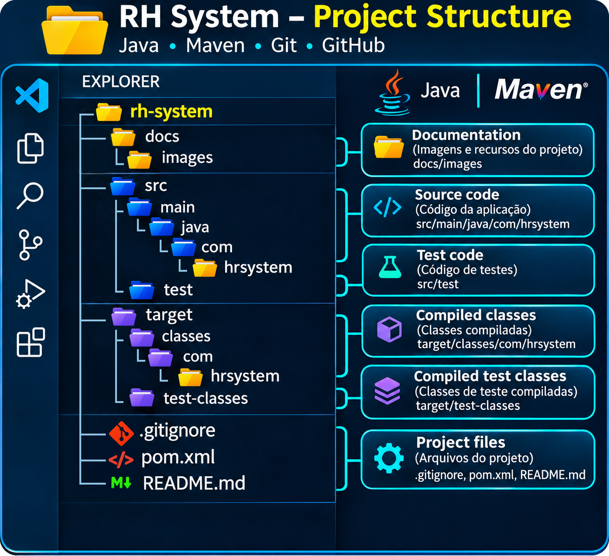

##


**A Java-based Human Resources and Payroll Management System.**

## 🇬🇧 English

### About the Project

RH System is a Human Resources Management System developed in Java. Its main goal is to manage employee information and demonstrate the application of Object-Oriented Programming (OOP) principles in a practical project.

The project is being developed as part of a Java learning and professional portfolio initiative.

### Objectives

- Apply Object-Oriented Programming principles.
- Work with interfaces, classes, inheritance and polymorphism.
- Develop payroll calculation and management logic.
- Practice clean code and software organization.
- Apply Git and GitHub version control best practices.

### Technologies

- Java 21
- Apache Maven
- Object-Oriented Programming (OOP)
- Git
- GitHub
- JUnit (planned)

### Planned Features

- Employee management.
- Different employee roles, such as Developer and Manager.
- Payroll calculation.
- Salary management using `BigDecimal`.
- Automated unit testing.

### Project Structure


### Getting Started

**Prerequisites**

- Java Development Kit (JDK) 21
- Apache Maven

**Build the project**

```bash
mvn clean compile
```

### Project Status

Currently under development.

---

## 🇵🇹 Português

### Sobre o Projeto

O RH System é um Sistema de Gestão de Recursos Humanos desenvolvido em Java. O seu principal objetivo é gerir informações dos colaboradores e demonstrar a aplicação dos conceitos de Programação Orientada a Objetos (POO) num projeto prático.

O projeto está a ser desenvolvido como parte de um processo de aprendizagem em Java e construção de portfólio profissional.

### Objetivos

- Aplicar os princípios da Programação Orientada a Objetos.
- Trabalhar com interfaces, classes, herança e polimorfismo.
- Desenvolver regras de cálculo e gestão de salários.
- Praticar código limpo e organização de software.
- Aplicar boas práticas de controlo de versões com Git e GitHub.

### Tecnologias

- Java 21
- Apache Maven
- Programação Orientada a Objetos (POO)
- Git
- GitHub
- JUnit (planeado)

### Funcionalidades Planeadas

- Gestão de colaboradores.
- Diferentes funções profissionais, como Developer e Manager.
- Cálculo de folhas de pagamento.
- Gestão salarial utilizando `BigDecimal`.
- Testes unitários automatizados.

### Estrutura do Projeto


### Como Começar

**Pré-requisitos**

- Java Development Kit (JDK) 21
- Apache Maven

**Compilar o projeto**

```bash
mvn clean compile
```

### Estado do Projeto

Atualmente em desenvolvimento.

---

**Developed as a Java portfolio project.**  
**Desenvolvido como projeto de portfólio em Java.**
